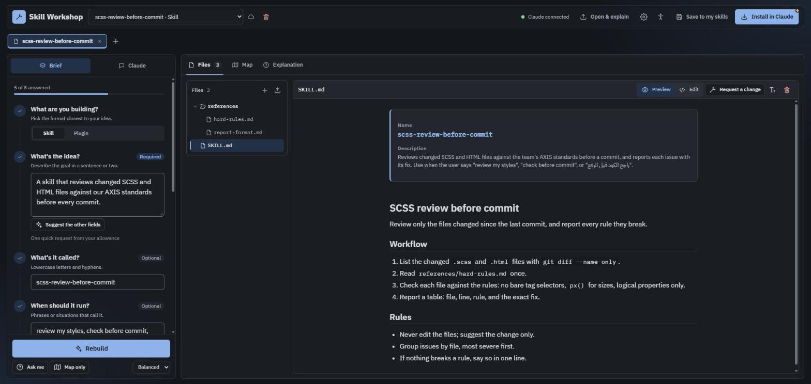
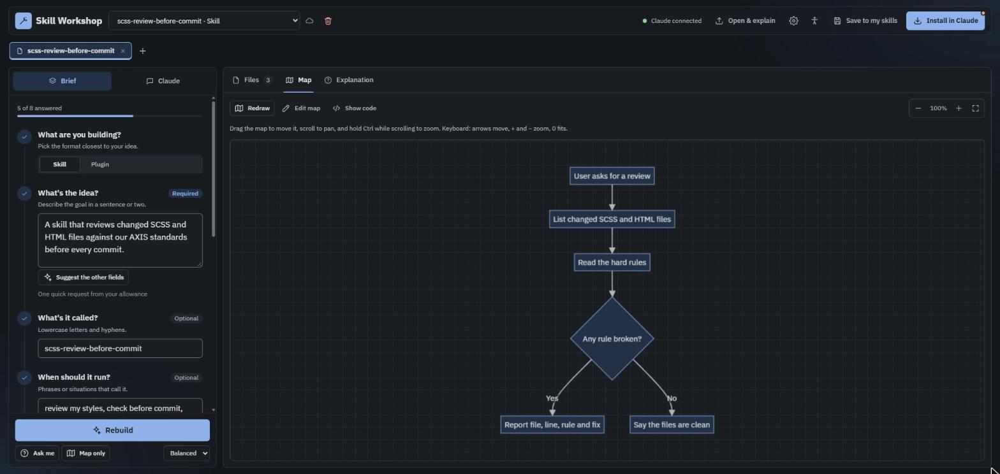

# skill-workshop

**Skill Workshop** (ورشة المهارات) is a page for building, reading, and maintaining Claude skills. It runs as a claude.ai Artifact, so it has no backend of its own. Claude calls use the viewer's own account.

- Build a skill or a plugin from a short brief, with reference files, images, and links.
- Open an existing skill (ZIP, folder, or files) and have Claude explain it and draw its idea map.
- Keep your skills in a private library ("مهاراتي"), open several as tabs, edit them, and install them in claude.ai or Claude Code.
- English (the default, LTR) and Arabic (RTL), light and dark themes, and accessibility tools. The idea map is always written in English.





<div dir="rtl" lang="ar">

## بالعربية باختصار

ورشة المهارات صفحة على claude.ai تبني فيها Skills وPlugins لـ Claude، وتفتح فيها Skill موجودة ليشرحها Claude ويرسم خريطتها، ثم تحفظها في مكتبتك وتثبّتها في Claude.

**لتشغيلها عندك:**

1. ثبّت Node.js (الإصدار 20 أو أحدث) وGit، وافتح Claude Code مسجّلًا بحسابك على claude.ai.
2. اكتب في الـ Terminal الأمرين:

</div>

```bash
claude plugin marketplace add ezzeldenalqemam/skill-workshop
```

```bash
claude plugin install skill-workshop@skill-workshop
```

<div dir="rtl" lang="ar">

3. افتح جلسة جديدة في Claude Code واكتب الأمر التالي، أو اطلب: «شغّل ورشة المهارات».

</div>

```
/skill-workshop:setup
```

<div dir="rtl" lang="ar">

ينزّل Claude المشروع ويبنيه، ثم ينشر نسخة خاصة بك على claude.ai ويعطيك رابطها. لتحديثها لاحقًا كرّر الأمر نفسه؛ يبقى الرابط وتبقى أعمالك المحفوظة.

</div>

## Get your own copy with the plugin (easiest)

The repository is also a Claude Code plugin marketplace. The `skill-workshop` plugin downloads this project, builds it, and publishes your own private copy on claude.ai, ready to use with Claude.

You need Node.js 20 or newer, Git, and Claude Code (the desktop app's Code tab or the CLI) signed in with your claude.ai account.

1. Install the plugin once:

   ```bash
   claude plugin marketplace add ezzeldenalqemam/skill-workshop
   ```

   ```bash
   claude plugin install skill-workshop@skill-workshop
   ```

2. Start a new Claude Code session, then type:

   ```
   /skill-workshop:setup
   ```

   or just ask: "set up Skill Workshop" / «شغّل ورشة المهارات».

Claude checks your tools, downloads the project into `./skill-workshop`, builds it, publishes the page, and gives you its link. Run the same command later to update: the link and your saved work stay.

To try it on your computer without publishing (Claude's buttons then use a mock), use `/skill-workshop:dev`.

## Run it locally

You need Node.js 20 or newer.

```bash
npm ci
npm start
```

Then open http://localhost:38291/?mock-claude

The dev server always uses port **38291**, set in `angular.json`. It is an uncommon port, outside the range Windows hands out to programs, so it stays clear of other apps.

Locally, Claude's buttons talk to a mock (`src/dev/claude-mock.js`) that returns fixed replies. Real Claude only answers when the page is published as an Artifact on claude.ai.

Mock options, added to the URL:

| Option | Effect |
|---|---|
| `&slow` | Each reply waits 4 seconds, to see loading states |
| `&no-tools` | Claude answers in JSON mode instead of calling page tools |

## Publish your own copy on claude.ai

```bash
npm run build:artifact
```

Then ask Claude Code to publish `dist/artifact/index.html` as an Artifact, with the other files in `dist/artifact` as its files and these capabilities:

```
sample: { images: true }, db: { rules: [{ path: "library", read: "owner", write: "owner" }] }, downloads: true, user: {}
```

The `library` rule keeps your saved skills readable and writable by you alone, even when you share the page. `images: true` lets Claude see the reference images you add.

## Project layout

| Path | What it holds |
|---|---|
| `src/app/core` | Services: Claude agent, workspace store, persistence, i18n |
| `src/app/features` | Brief, chat, file tree and viewer, idea map, explanation, start screen |
| `src/app/layout` | Header and project tabs |
| `src/app/shared` | Icons, dialogs, popovers, drop zone, accessibility panel |
| `src/assets/scss` | Styles following the AXIS architecture (ITCSS + BEM) |
| `scripts/build-artifact.mjs` | Turns the Angular build into an Artifact page |
| `plugin/` | The `skill-workshop` Claude Code plugin (setup and dev commands) |
| `.claude-plugin/marketplace.json` | Makes this repository a plugin marketplace |
| `docs/accessibility/` | The accessibility audit plan and progress log |
| `docs/screenshots/` | The screenshots in this README |
